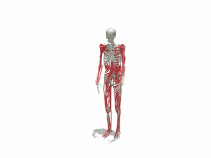

# muscle-supermimic

**Whole-body motion tracking for musculoskeletal humanoids with one differentiable world model:**
[SuperMimic](https://arxiv.org/abs/2610.28480) driving MS-Human-700 (700 muscles) and MyoFullBody (354
muscles), on [mjlab](https://github.com/mujocolab/mjlab) / MuJoCo-Warp.

<p align="center">
  
  <br><sub>MyoFullBody (solid, muscles in red) tracking a KIT turning clip; the reference is the translucent ghost.</sub>
</p>

SuperMimic trains a tracking policy by backpropagating through rollouts of a learned world model of the
body. This repository runs it on muscle-driven humanoids, with MuscleMimic's tracking task: the policy sets
the excitation of every muscle at 100 Hz to follow motion-capture clips.

- **Two whole-body muscle models.** MS-Human-700 (37 joint DoF, 700 muscles; also with locked hands) and
  MuscleMimic's MyoFullBody (31 joint DoF, 354 muscles), as mjlab tasks.
- **One MDP, simulated and imagined.** Every observation, reward and termination is an analytic function of
  the state, used by the simulator's managers and by the imagined rollouts alike; tests check that both agree.
- **Differentiable muscles.** A torch replica of MuJoCo's spatial tendons and Hill muscles gives muscle
  length, velocity and force on imagined states, equal to MuJoCo's to 1e-9 / 1e-8 / 1e-6.
- **Motion data for both.** MuscleMimic's retargeted AMASS (KIT) clips drive MyoFullBody as they are;
  `ms-retarget-myofullbody` carries them over to MS-Human-700.

## Status

Research code, in progress.

- **MyoFullBody** on MuscleMimic's KIT split (972 training clips): one run (Euler, 4096 envs, one RTX 5090)
  reached, at iteration 12000 (10.7 h), training episodes of 268 steps on average, 7 % of them ending in a
  failure. Evaluated on whole clips from their first frame, it scores a normalized return of 0.77 on
  MuscleMimic's 108 held-out clips, 101 of them tracked to the end (0.79 on 3 training clips).
- **MS-Human-700** (locked hands) on the same clips retargeted to it: training.
- **Known issue**: the policy gradient through imagination can explode along the loop muscle-velocity
  observation → policy → activation → world model; the MyoFullBody run above collapsed that way from
  iteration ~12700. A per-trajectory clip of the gradient on the imagined state is being evaluated.

## Install

```bash
git clone --recursive https://github.com/kaibohex/muscle-supermimic.git   # MS-Human-700 is a submodule
cd muscle-supermimic
uv sync           # Python 3.12; mjlab 1.6.0 (torch, MuJoCo-Warp), musclemimic-models 1.0.6
uv run pytest     # CPU, ~1.5 min; tests/test_env.py needs the test clips (docs/motion_data.md)
```

## Quick start

MyoFullBody on MuscleMimic's retargeted KIT clips (a gated dataset: accept its terms on the
[dataset page](https://huggingface.co/datasets/amathislab/musclemimic-retargeted) first):

```bash
uvx --from huggingface_hub hf auth login
uvx --from huggingface_hub hf download amathislab/musclemimic-retargeted --repo-type dataset \
    --include "MyoFullBody/gmr/KIT/*" --local-dir data/musclemimic

# train on MuscleMimic's training list, with MuscleMimic's solver settings
uv run train Mjlab-SuperMimic-Flat-MyoFullBody --env.commands.motion.motion-file data/musclemimic/kit_kinesis_train.txt \
    --env.sim.mujoco.integrator euler --env.sim.mujoco.iterations 100 --env.sim.mujoco.ls-iterations 50

# evaluate a checkpoint on the held-out list, record the rollouts and render them
uv run ms-eval --task Mjlab-SuperMimic-Flat-MyoFullBody --checkpoint logs/rsl_rl/myofullbody_tracking/<run>/model_012000.pt \
    --motion-file data/musclemimic/kit_kinesis_test.txt --record rollout.npz
uv run ms-render rollout.npz videos/
```

MS-Human-700 on the same clips, retargeted from MyoFullBody (CPU, ~20 min):

```bash
uv run ms-retarget-myofullbody data/mshuman700_kit data/musclemimic/kit_kinesis_train.txt data/musclemimic/kit_kinesis_test.txt --workers 6
uv run train Mjlab-SuperMimic-Flat-MS-Human-700-Locked-Hands --env.commands.motion.motion-file data/mshuman700_kit/kit_kinesis_train.txt \
    --env.sim.mujoco.integrator euler --env.sim.mujoco.iterations 100 --env.sim.mujoco.ls-iterations 50
```

MyoFullBody fits a 24 GB GPU and MS-Human-700 a 32 GB one at the default 4096 envs; see
[docs/training.md](docs/training.md) for smaller settings, evaluation while training and mjlab's viewer.

## Tasks

| Task | Joint DoF | Muscles |
|---|---|---|
| `Mjlab-SuperMimic-Flat-MS-Human-700` | 37 + free root | 700 |
| `Mjlab-SuperMimic-Flat-MS-Human-700-Locked-Hands` | 33 + free root | 694 |
| `Mjlab-SuperMimic-Flat-MyoFullBody` | 31 + free root | 354 |

The tasks register through mjlab's `mjlab.tasks` entry point with the SuperMimic runner, so mjlab's own
`train` and `play` run them.

## Documentation

- [Models](docs/models.md): what changes from the upstream MS-Human-700 and MyoFullBody, locked hands.
- [Motion data](docs/motion_data.md): clip formats, MuscleMimic's KIT split, retargeting to MS-Human-700.
- [MDP](docs/mdp.md): observation, goal, reward, terminations, and how simulator and imagination share them.
- [Training](docs/training.md): the algorithm and its settings, commands, solver, memory and speed.

## Layout

| Path | What |
|---|---|
| `src/muscle_supermimic/assets/robots/` | the two robots as mjlab `EntityCfg`s, and `ModelInfo` (root, independent and coupled joints, muscles) |
| `src/muscle_supermimic/tasks/tracking/` | the task: env cfg, `mdp/` (FK, muscle geometry and activation, motion library, analytic terms), per-robot configs, `scripts/` (`ms-convert-motion`, `ms-retarget-myofullbody`, `ms-eval`, `ms-render`) |
| `src/muscle_supermimic/rl/supermimic/` | the SuperMimic runner, world model / policy / critic, replay buffer, config |
| `third_party/MS-Human-700/` | the upstream MS-Human-700 model (git submodule) |
| `tests/` | FK, muscles and activation vs MuJoCo, retargeting, simulator vs analytic terms, a tiny end-to-end training run |

## Citation

This code builds on the following works; please cite them if you use it:

- SuperMimic: Q. Liao et al., *SuperMimic: Scaling Humanoid Whole-Body Control with One Differentiable
  World Model*, CoRL 2026, [arXiv:2610.28480](https://arxiv.org/abs/2610.28480).
- MuscleMimic: Li et al., *Towards Embodied AI with MuscleMimic*,
  [arXiv:2603.25544](https://arxiv.org/abs/2603.25544), [code](https://github.com/amathislab/musclemimic).
- MS-Human-700: [LNSGroup/MS-Human-700](https://github.com/LNSGroup/MS-Human-700).
- mjlab: [mujocolab/mjlab](https://github.com/mujocolab/mjlab).

## License and attribution

Apache License 2.0 ([LICENSE](LICENSE)); [NOTICE](NOTICE) carries the notices of the code it includes.

- The SuperMimic implementation is ported from [supermimic_vibed](https://github.com/zita-ch/supermimic_vibed)
  by Chong Zhang (MIT, Copyright (c) 2026 ETH Zurich, Chong Zhang); ported files say so in their docstrings.
- The MyoFullBody entity follows MuscleMimic's environment (Apache-2.0,
  `musclemimic/environments/humanoids/myofullbody.py`): the finger joints and muscles it removes, the mimic
  sites it tracks. Its license is in `third_party/musclemimic/LICENSE`; the KIT train/test lists in
  `data/musclemimic/` are MuscleMimic's (`loco_mujoco/smpl/const.py`).
- MS-Human-700 (Apache-2.0, LNSGroup), msgym's walking clip (Apache-2.0), mjlab (Apache-2.0).
- The MyoFullBody model comes from the `musclemimic-models` package (Apache-2.0), installed, not vendored. Its
  NOTICE lists what it derives from: MyoSuite / myo_sim (Apache-2.0) and OpenSim models, among them MoBL-ARMS
  (arm and hand), released for **non-commercial use only**.
- The motions are AMASS (KIT) clips under AMASS's license (non-commercial research, no redistribution); they
  are not part of this repository, and clips retargeted from them must not be redistributed either.
