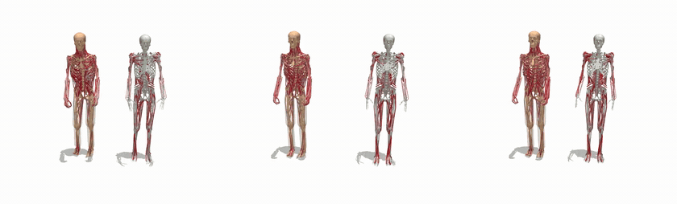
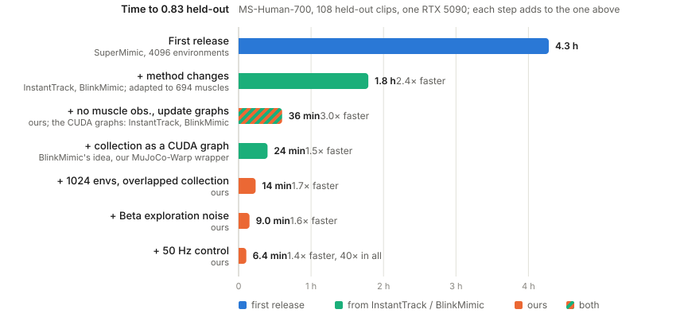

# muscle-supermimic

**Whole-body motion tracking for musculoskeletal humanoids with one differentiable world model:**
[SuperMimic](https://arxiv.org/abs/2610.28480) driving MS-Human-700 (700 muscles) and MyoFullBody (354
muscles), on [mjlab](https://github.com/mujocolab/mjlab) / MuJoCo-Warp.

<p align="center">
  
  <br><sub>Three KIT training clips (turning left, walking forward, walking backward), each tracked by MS-Human-700
  (left of the pair) and MyoFullBody (right), each with its own policy at iteration 10000; muscles are colored by
  activation, from light grey (0) to deep red (1).</sub>
</p>

SuperMimic trains a tracking policy by backpropagating through rollouts of a learned world model of the
body. This repository runs it on muscle-driven humanoids, with MuscleMimic's tracking task: the policy sets
the excitation of every muscle at 100 Hz to follow motion-capture clips.

- **Two whole-body muscle models.** MS-Human-700 (37 joint DoF, 700 muscles; also with locked hands) and
  MuscleMimic's MyoFullBody (31 joint DoF, 354 muscles), as mjlab tasks.
- **One MDP, simulated and imagined.** Every observation, reward and termination is an analytic function of
  the state, used by the simulator's managers and by the imagined rollouts alike; tests check that both agree.
- **Differentiable muscles.** A torch replica of MuJoCo's spatial tendons and Hill muscles gives muscle
  length, velocity and force on imagined states, equal to MuJoCo's to 1e-9 / 1e-8 / 1e-6.
- **Motion data for both.** MuscleMimic's retargeted AMASS (KIT) clips drive MyoFullBody as they are;
  `ms-retarget-myofullbody` carries them over to MS-Human-700.

## News

- **[2026-11]** The code of the fast training recipe is out: see [Fast training](#fast-training).
- **[2026-11]** Training sped up again, from 9 to 6.5 minutes.
- **[2026-11]** Training sped up again, from 14 to 9 minutes: MS-Human-700 passes a normalized return of 0.83 on the
  108 held-out clips after 9 minutes on one RTX 5090 with both of two seeds, with the compile caches warmed up. Code:
  [Fast training](#fast-training).
- **[2026-11]** Training sped up from 4 hours to 14 minutes: MS-Human-700 passes a normalized return of 0.83 on the 108
  held-out clips after 14 minutes on one RTX 5090, with the compile caches warmed up. Code: [Fast training](#fast-training).
- **[2026-10]** Checkpoints of both bodies on [Hugging Face](https://huggingface.co/Beanpow/muscle-supermimic), and an
  [interactive demo](https://muscle-supermimic.beanpow.top/demo/) on the [project page](https://muscle-supermimic.beanpow.top/)
  that runs both policies in the browser on 32 held-out clips.
- **[2026-10]** First release: SuperMimic tracking on MS-Human-700 and MyoFullBody.

## Status

Both bodies train on MuscleMimic's KIT split (972 training clips) with the defaults: 4096 environments on one RTX
5090. Evaluation plays each of MuscleMimic's 108 held-out clips once from its first frame, without exploration noise.

- **MS-Human-700** (locked hands, the clips retargeted to it): a normalized return of 0.83 after 4 hours
  (iteration 6500, 99 of 108 clips tracked to the end), 0.89-0.91 from 4.9 hours on, and 0.91 after 10.1 hours
  (iteration 16000, 104 tracked); iterations 10000, 14000, 14500 and 15500 track all 108.
- **MyoFullBody**: 0.83 after 6.0 hours (iteration 10000, 101 tracked) and 0.90 after 9.6 hours (iteration 16000,
  all 108 tracked).

The checkpoints of iterations 10000 and 16000 of both runs are on Hugging Face:
[Beanpow/muscle-supermimic](https://huggingface.co/Beanpow/muscle-supermimic).

## Fast training

`scripts/train_blink.sh` trains MS-Human-700 (locked hands, without muscle observations) to a normalized return of
0.83 on the 108 held-out clips in **6.4 minutes** on one RTX 5090, with both of two seeds (best 0.944 / 0.945),
against 4.3 hours for the first release. It ports the training speedups of
[BlinkMimic](https://github.com/fuyichen0725/blinkmimic) (which builds on
[InstantTrack](https://github.com/Huy-Quang-Dao/instantTrack)), changes the three that do not transfer to 694
muscles, and adds changes of our own. Every change is a runner flag, off by default: `uv run train` without them is
still the first release's training.

<p align="center">
  <picture>
    <source media="(prefers-color-scheme: dark)" srcset="docs/assets/fast_training_dark.svg">
    
  </picture>
  <br><sub>The first held-out evaluation at or above 0.83, MS-Human-700 with locked hands, one RTX 5090, warm compile
  caches. Each step adds to the one above, coloured by where it comes from: InstantTrack and BlinkMimic, ours, or both
  (striped).</sub>
</p>

```bash
bash scripts/train_blink.sh Mjlab-SuperMimic-Flat-MS-Human-700-Locked-Hands-No-Muscle-Obs \
    data/mshuman700_kit/kit_kinesis_train.txt --agent.run-name blink --agent.max-hours 0.3333
# the recipe controls at 50 Hz: evaluate at the same rate
uv run ms-eval --task Mjlab-SuperMimic-Flat-MS-Human-700-Locked-Hands-No-Muscle-Obs --decimation 10 --stride 10 \
    --checkpoint logs/rsl_rl/mshuman700_tracking/<run>/model_<iteration>.pt --motion-file data/mshuman700_kit/kit_kinesis_test.txt
```

The times are with warm compile caches: a fresh machine first compiles for 5-10 minutes inside the training clock,
unless it loads caches saved with `scripts/compile_cache.sh`.

**Taken from BlinkMimic and InstantTrack**, as they are:

- the deployed policy is a Polyak average (EMA 0.995) of the trained one (InstantTrack);
- Muon on the hidden weight matrices of the policy and the world model, Adam elsewhere (BlinkMimic);
- no host synchronization in the update loop, and fused Adam (InstantTrack);
- learning rate 4e-4 and a 3 x 1024 world model with 5 batches per iteration (InstantTrack); an imagination batch of
  2048 (BlinkMimic);
- reset statistics averaged per clip bin before their EMA step (BlinkMimic), and 30 % of the resets just before
  recent failure points (InstantTrack);
- a semi-implicit world model (it predicts velocity increments and integrates positions as the Euler substeps do)
  and the left-right mirror image of half of each world-model batch (BlinkMimic);
- the world-model and policy updates as CUDA graphs (InstantTrack / BlinkMimic), and the collection step as a CUDA
  graph (BlinkMimic's idea; here a thin wrapper around MuJoCo-Warp, `rl/supermimic/collector.py`).

**Changed for 694 muscles**: three of BlinkMimic's G1 settings fail on MS-Human-700.

- No world-model warm-up and unclamped bootstrapped values: the critic diverges from the first policy updates.
  Here the bootstrapped values are clamped to the attainable maximum and the world model trains alone for 200
  iterations.
- A 4x policy learning rate early on: the policy degrades after about 1000 iterations, and even 2x stalls about half
  of the runs. Here it stays at 1x.
- Evaluation-guided resets: on 5 s clips every probe fails within 3 s of its start, and the sweeps cost half the
  training time. Here they are off.

**Our own changes**:

- Task variants without muscle observations (`-No-Muscle-Obs`): the policy no longer sees muscle length, velocity
  and force, which removes the muscle geometry, the costliest part of an imagined step. On MyoFullBody the policy
  update takes half the time, with the same learning curve over 16000 iterations.
- 1024 environments instead of 4096, with the collection on a second CUDA stream, concurrent with the updates.
- Exploration noise drawn from a Beta distribution whose mean is the policy's excitation, instead of a Gaussian
  clipped to [0, 1], which adds a tonic co-contraction to the muscles the policy keeps nearly silent.
- 50 Hz control: 10 physics substeps per policy step instead of 5, every step-counted setting rescaled to keep its
  duration (horizon, discount, buffer, world-model windows, goal spacing, simulator steps per iteration), and the
  exploration noise scaled by 1/sqrt(2) to keep its variance per second.

Each step adds to the one above (MS-Human-700 with locked hands, one RTX 5090, warm compile caches):

| | first 0.83 on the held-out clips | s / iteration |
|---|---|---|
| first release (4096 environments) | 4.3 h | 2.38 |
| + the method changes of BlinkMimic and InstantTrack, changed for 694 muscles | 1.8 h | 1.89 |
| + no muscle observations, the updates as CUDA graphs | 36 min | 0.67 |
| + the collection step as a CUDA graph | 24 min | 0.48 |
| + 1024 environments, the collection concurrent with the updates | 14 min | 0.24 |
| + Beta exploration noise, no rematerialization of the imagined steps | 9 min | 0.21 |
| + 50 Hz control | 6.4 min | 0.14 |

The last two rows hold for two seeds each, the others are single runs.
[docs/training.md](docs/training.md) ("BlinkMimic recipe") lists every flag, what each setting does, and the
iteration's time piece by piece.

## Install

```bash
git clone --recursive https://github.com/kaibohex/muscle-supermimic.git   # MS-Human-700 is a submodule
cd muscle-supermimic
uv sync           # Python 3.12; mjlab 1.6.0 (torch, MuJoCo-Warp), musclemimic-models 1.0.6
uv run pytest     # CPU, ~1.5 min; tests/test_env.py needs the test clips (docs/motion_data.md)
```

## Quick start

MyoFullBody on MuscleMimic's retargeted KIT clips (a gated dataset: accept its terms on the
[dataset page](https://huggingface.co/datasets/amathislab/musclemimic-retargeted) first):

```bash
uvx --from huggingface_hub hf auth login
uvx --from huggingface_hub hf download amathislab/musclemimic-retargeted --repo-type dataset \
    --include "MyoFullBody/gmr/KIT/*" --local-dir data/musclemimic

# train on MuscleMimic's training list
uv run train Mjlab-SuperMimic-Flat-MyoFullBody --env.commands.motion.motion-file data/musclemimic/kit_kinesis_train.txt

# evaluate a checkpoint on the held-out list (a GPU takes ~30 s for the 108 clips), record the rollouts and render them
uv run ms-eval --task Mjlab-SuperMimic-Flat-MyoFullBody --checkpoint logs/rsl_rl/myofullbody_tracking/<run>/model_<iteration>.pt \
    --motion-file data/musclemimic/kit_kinesis_test.txt --record rollout.npz
uv run ms-render rollout.npz videos/
```

MS-Human-700 on the same clips, retargeted from MyoFullBody (CPU, ~20 min):

```bash
uv run ms-retarget-myofullbody data/mshuman700_kit data/musclemimic/kit_kinesis_train.txt data/musclemimic/kit_kinesis_test.txt --workers 6
uv run train Mjlab-SuperMimic-Flat-MS-Human-700-Locked-Hands --env.commands.motion.motion-file data/mshuman700_kit/kit_kinesis_train.txt

# the retargeted reference itself, replayed kinematically (no controller)
uv run ms-render data/mshuman700_kit/359/turn_left05_poses.npz videos/ --lock-hands
```

MyoFullBody fits a 24 GB GPU and MS-Human-700 a 32 GB one at the default 4096 envs; see
[docs/training.md](docs/training.md) for smaller settings, evaluation while training and mjlab's viewer.

## Tasks

| Task | Joint DoF | Muscles |
|---|---|---|
| `Mjlab-SuperMimic-Flat-MS-Human-700` | 37 + free root | 700 |
| `Mjlab-SuperMimic-Flat-MS-Human-700-Locked-Hands` | 33 + free root | 694 |
| `Mjlab-SuperMimic-Flat-MyoFullBody` | 31 + free root | 354 |

The tasks register through mjlab's `mjlab.tasks` entry point with the SuperMimic runner, so mjlab's own
`train` and `play` run them.

## Documentation

- [Project page](docs/website/index.html): results, videos and the method in one page (published to GitHub Pages).
- [Models](docs/models.md): what changes from the upstream MS-Human-700 and MyoFullBody, locked hands.
- [Motion data](docs/motion_data.md): clip formats, MuscleMimic's KIT split, retargeting to MS-Human-700.
- [MDP](docs/mdp.md): observation, goal, reward, terminations, and how simulator and imagination share them.
- [Training](docs/training.md): the algorithm and its settings, commands, solver, memory and speed.

## Layout

| Path | What |
|---|---|
| `src/muscle_supermimic/assets/robots/` | the two robots as mjlab `EntityCfg`s, and `ModelInfo` (root, independent and coupled joints, muscles) |
| `src/muscle_supermimic/tasks/tracking/` | the task: env cfg, `mdp/` (FK, muscle geometry and activation, motion library, analytic terms), per-robot configs, `scripts/` (`ms-retarget-myofullbody`, `ms-eval`, `ms-render`) |
| `src/muscle_supermimic/rl/supermimic/` | the SuperMimic runner, world model / policy / critic, replay buffer, config |
| `third_party/MS-Human-700/` | the upstream MS-Human-700 model (git submodule) |
| `tests/` | FK, muscles and activation vs MuJoCo, retargeting, simulator vs analytic terms, a tiny end-to-end training run |

## Citation

If you use this code, please cite:

```bibtex
@misc{he2026musclesupermimic,
  title        = {{muscle-supermimic}: Whole-Body Motion Tracking for
                  Musculoskeletal Humanoids with One Differentiable
                  World Model},
  author       = {He, Kaibo and Bakowicz, Maciej and Zhou, Shihe and
                  Sui, Yanan and Radhakrishnan, Dhanush},
  year         = {2026},
  howpublished = {\url{https://github.com/kaibohex/muscle-supermimic}},
  note         = {Project page: \url{https://muscle-supermimic.beanpow.top}}
}
```

## Related work

It builds on the following works; please cite them as well:

- SuperMimic: Q. Liao et al., *SuperMimic: Scaling Humanoid Whole-Body Control with One Differentiable
  World Model*, CoRL 2026, [arXiv:2610.28480](https://arxiv.org/abs/2610.28480).
- MuscleMimic: Li et al., *Towards Embodied AI with MuscleMimic*,
  [arXiv:2603.25544](https://arxiv.org/abs/2603.25544), [code](https://github.com/amathislab/musclemimic).
- MS-Human-700: [MuJoCo Menagerie, ms_human_700](https://github.com/google-deepmind/mujoco_menagerie/tree/main/ms_human_700).
- mjlab: [mujocolab/mjlab](https://github.com/mujocolab/mjlab).
- BlinkMimic: F. Chen, [fuyichen0725/blinkmimic](https://github.com/fuyichen0725/blinkmimic), and InstantTrack,
  [Huy-Quang-Dao/instantTrack](https://github.com/Huy-Quang-Dao/instantTrack), for the fast training recipe.

## License and attribution

Apache License 2.0 ([LICENSE](LICENSE)); [NOTICE](NOTICE) carries the notices of the code it includes.

- The SuperMimic implementation is ported from [supermimic_vibed](https://github.com/zita-ch/supermimic_vibed)
  by Chong Zhang (MIT, Copyright (c) 2026 ETH Zurich, Chong Zhang); ported files say so in their docstrings.
- The BlinkMimic pieces of the runner (`rl/supermimic/optim.py`; the policy EMA, the update loop without host
  synchronization, the Muon split, the policy learning-rate schedule and the reset-statistics fixes) and
  `scripts/train_blink.sh` are ported from BlinkMimic (MIT, Copyright (c) 2026 Fuyi Chen), which derives from
  InstantTrack (MIT). The optional DEP controller (`rl/supermimic/dep.py`) is ported from
  [depRL](https://github.com/martius-lab/depRL) (MIT).
- The MyoFullBody entity follows MuscleMimic's environment (Apache-2.0,
  `musclemimic/environments/humanoids/myofullbody.py`): the finger joints and muscles it removes, the mimic
  sites it tracks. Its license is in `third_party/musclemimic/LICENSE`; the KIT train/test lists in
  `data/musclemimic/` are MuscleMimic's (`loco_mujoco/smpl/const.py`).
- MS-Human-700 (Apache-2.0, LNSGroup), mjlab (Apache-2.0).
- The MyoFullBody model comes from the `musclemimic-models` package (Apache-2.0), installed, not vendored. Its
  NOTICE lists what it derives from: MyoSuite / myo_sim (Apache-2.0) and OpenSim models, among them MoBL-ARMS
  (arm and hand), released for **non-commercial use only**.
- The motions are AMASS (KIT) clips under AMASS's license (non-commercial research, no redistribution); they
  are not part of this repository, and clips retargeted from them must not be redistributed either.
